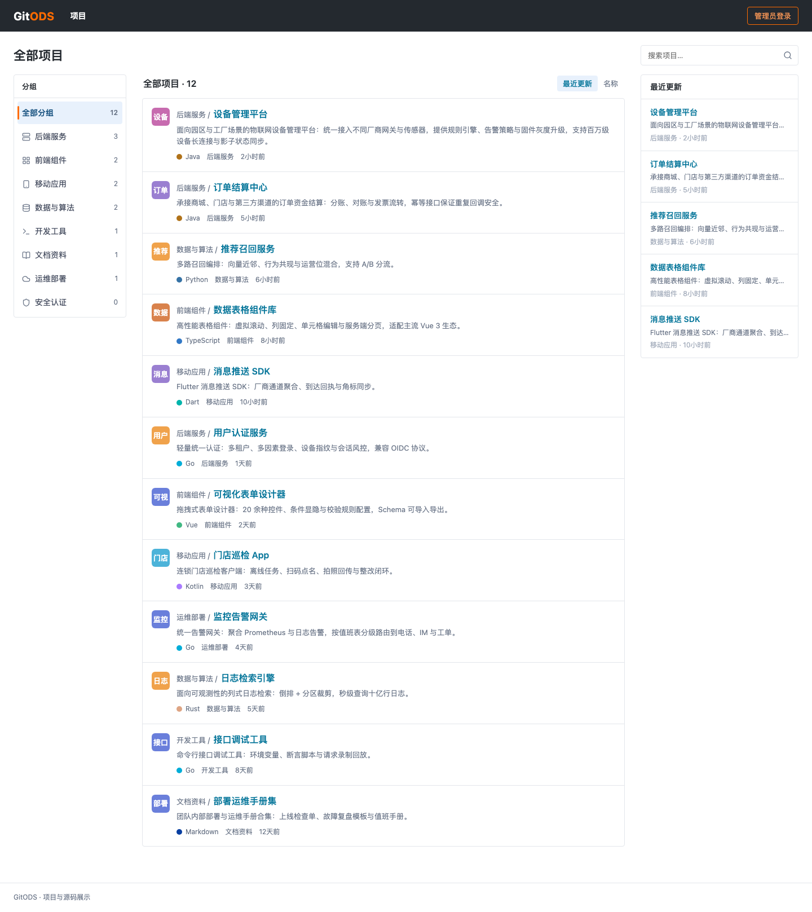
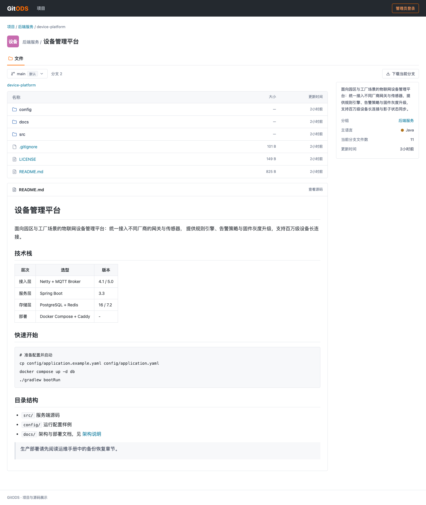
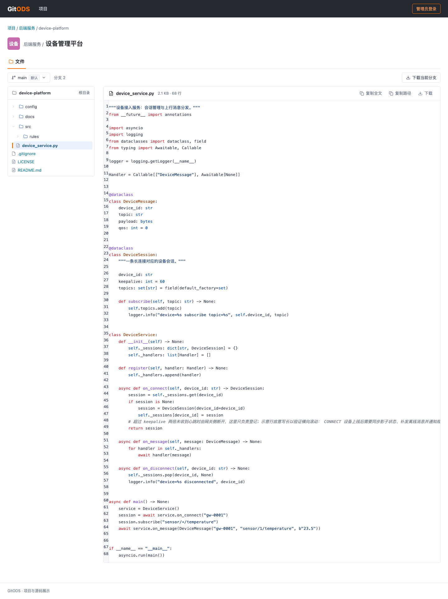

# GitODS

Gitee 风格的公开项目与源码展示站：管理员自由创建分组与项目，通过**实际独立的分支**组织不同文件集合；访客无需登录即可浏览目录、源码、README 并下载文件或整分支 ZIP。


## 功能特性

- **Gitee 式界面**：白底细边框、蓝绿链接、橙色强调的三栏发现页与项目文件页；源码高亮（行号 + `#L42` 定位）、Markdown 渲染、受控图片预览
- **真实独立分支**：空分支 / 从现有分支复制；两个分支各持独立文件集合，复制共享不可变内容对象，改动互不影响；默认分支与最后一个分支受保护
- **文件维护**：批量上传（同名冲突 → 明确覆盖确认）、新建文件夹、改名（目录级联更新后代路径）、删除
- **ZIP 导入 / 导出**：导入前完整校验（路径穿越、符号链接、损坏 CRC、加密、`.env` 拒绝，`.git/` 等自动排除）→ 预览确认 → **整分支原子替换**；导出含空目录，仅当前分支
- **文件树导航**：进入目录或文件后左侧展示整棵文件树，当前路径自动展开高亮，左右联动
- **公开只读 + 管理员写**：访客公开浏览；无开放注册；登录失败限流（按用户名 + IP）
- **不是 Git**：没有提交历史、PR、合并、diff 或 Git 服务——按内容寻址的对象存储 + 目录元数据实现"分支"语义

## 截图

| 发现页 | 项目文件页 |
| --- | --- |
|  |  |

源码页（左侧文件树 + 高亮 + 行定位）：



## 快速开始（开发）

依赖 Python 3.12+ 与一个可访问的 PostgreSQL（本地已有实例时只需在 `.env` 指向它）：

```bash
python3 -m venv .venv && .venv/bin/pip install -r requirements-dev.txt
cp .env.example .env            # 填 DATABASE_URL 等本地配置
.venv/bin/python manage.py migrate
.venv/bin/python manage.py seed_demo --reset --force   # 可选：8 分组 × 12 项目演示数据
.venv/bin/python manage.py runserver
```

打开 http://127.0.0.1:8000/explore/ ；管理员 `.venv/bin/python manage.py createsuperuser` 创建（无默认账号密码）。

## 部署（Docker Compose）

三服务编排：`web`（Gunicorn + WhiteNoise，非 root）/ `db`（PostgreSQL 17，不对外暴露）/ `nginx`（反向代理，请求体上限 64 MiB；HTTPS 见运维手册）。

```bash
cp .env.example .env           # SECRET_KEY、数据库密码、域名
docker compose build && docker compose up -d db
docker compose run --rm web python manage.py migrate
docker compose run --rm web python manage.py createsuperuser
docker compose up -d
```

备份 / 灾难恢复 / 停机清理 / TLS 配置见 [docs/operations.md](docs/operations.md)。

## 测试

```bash
.venv/bin/python -m pytest tests -q                 # 全量（真实 PostgreSQL，禁用 SQLite）
.venv/bin/python -m pytest tests/e2e -q             # Playwright 浏览器闭环与视觉验收
```

覆盖分支隔离、ZIP 恶意样本矩阵、并发发布（同基准仅一胜）、权限边界、登录限流、渲染安全（转义 / 危险协议 / 图片校验）与响应式布局。

## 技术栈

Django 5.2 LTS · PostgreSQL 17 · HTMX · Pygments · markdown-it-py + nh3 · Pillow · WhiteNoise · Gunicorn · nginx。无 Node 构建链、无 Redis/Celery/对象存储依赖；文件内容按 SHA-256 寻址存放于私有数据目录，永不修改。

## 文档

- [产品与技术设计文档](docs/superpowers/specs/2026-10-24-gitods-design.md)
- [实施计划与逐任务验证记录](docs/superpowers/plans/2026-10-24-gitods.md)
- [运维手册（部署/备份/恢复/清理）](docs/operations.md)
