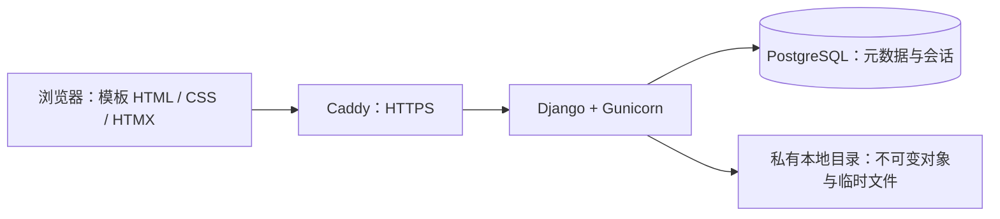

# GitODS 产品与技术设计文档

版本：1.0 · 日期：2026-10-24 · 状态：供 Claude Code 实施与用户审阅

## 1. 产品定义与已确认决策

GitODS 是一个采用 Gitee 风格的公开项目与源码展示站。管理员自由创建分组，在分组中创建项目，上传项目文件，并通过实际可切换的分支组织不同文件集合。访客无需登录即可浏览项目、目录、源码和 README，也可以下载文件或当前分支。

本次交付是设计和实施计划，不包含应用实现或上线操作。当前工作目录为空，尚未初始化 Git；技术选择不受现有代码限制。

| 决策 | 首版约定 |
|---|---|
| 公开与管理 | 访客公开只读；管理员登录后管理；没有开放注册 |
| 分组 | 管理员自由增删改排序；一级分组；一个项目属于一个分组 |
| 项目 | 创建、编辑、移动分组、删除；展示介绍、主语言、许可证文字 |
| 分支 | 每个分支独立文件；支持创建空分支、从现有分支复制、切换、设为默认、删除 |
| Git | 不依赖 Git 命令、Git 服务或 Git 仓库；没有提交记录、PR、合并、diff、远程同步 |
| 技术栈 | **Python + Django + PostgreSQL**；不用 SQLite；不另设前后端服务 |
| 页面 | 优先保证 Gitee 式列表页、项目文件页和源码预览状态好看 |

分支保留是用户后续明确的要求，优先于早期“去掉分支”的讨论。数据库中的 `revision` 仅用于并发校验，不是提交记录，不在页面展示历史。

## 2. 参考依据与复刻边界

- [Gitee 项目发现页](https://gitee.com/explore)
- [Gitee 项目文件页](https://gitee.com/kangweft/tr069)
- [用户提供的发现页截图](../../references/gitee-explore.png)
- [用户提供的项目页截图](../../references/gitee-project.png)

已通过浏览器查看两个参考页面；网页读取工具不能直接抓取，但浏览器可访问。以用户截图中的核心内容区为主要视觉依据。截图包含浏览器缩放，本文尺寸是实施用 CSS 基线，不声称是 Gitee 官方尺寸。

复刻信息布局、密度、色彩、表格与导航风格。站名使用 GitODS，制作简单文字标识；不搬入 Gitee 的广告、注册横幅、企业服务入口、认证徽章、第三方项目数据或页脚公司信息。生产环境不抓取 Gitee 数据，不请求 Gitee 接口。

## 3. 功能范围

### 3.1 分组与项目

- 分组字段：名称、URL 标识、简介、预设线性图标、排序值。名称 1–40 字，URL 标识 2–50 位小写字母、数字及连字符，全站唯一。
- 分组只分一级；数量不写死，也不把“Java、人工智能”等分类写死在代码中。
- 分组名称可修改，URL 标识创建后固定。排序按 `sort_order, id`。
- 非空分组禁止删除，显示项目数量，并引导先移动或删除项目；不级联删除项目。
- 项目字段：所属分组、名称、组内唯一 URL 标识、简介、主语言、许可证文字、默认分支、创建及更新时间。
- 项目名称 1–80 字，简介最多 500 字；URL 标识规则同分组，创建后固定。分组标识禁止 `admin/api/explore/static/healthz` 等系统保留词。
- 新项目自动创建空 `main`，并设为默认分支。允许没有文件的新项目公开存在。
- 移动项目时检查目标分组内 URL 标识冲突；成功后跳到新地址。旧地址返回清晰的 404，首版不实现历史地址重定向。
- 项目删除需输入项目名称确认，删除项目及其分支、文件元数据；对象文件由维护清理回收。

### 3.2 分支

- 同一项目内分支名唯一，首版采用 1–64 位小写字母、数字、点、下划线和连字符，首位为字母或数字，不允许 `..`；如 `main`、`release-1.0`。首版不支持分支改名和斜杠名称。
- 创建时选择“空分支”或“复制现有分支当前文件”。复制保留文件路径与内容，不保留任何修改历史。
- 所有后续上传、删除、重命名、README、预览与下载都限定在当前分支。
- 复制后可共享不可变文件对象，但文件目录元数据独立；修改任一分支不得改变另一个分支。
- 未指定分支的项目入口解析默认分支，临时重定向到带稳定分支 ID 的地址，便于刷新和分享。
- 分支选择器显示名称与“默认”标记；切换尽量保留当前目录或文件路径。
- 目标分支没有同一路径时保留该路径上下文，显示“此路径在该分支中不存在”及“返回该分支根目录”；不静默显示其他文件。
- 默认分支和最后一个分支均禁止删除。设置默认、删除、导入在服务端校验归属与并发。
- 删除当前分支后进入默认分支根目录；修改默认分支不强行切换已有浏览地址。

### 3.3 文件维护

- 支持一次上传多个文件到当前目录、新建文件夹、文件/文件夹重命名、删除文件/非空文件夹。
- 首版不实现在线编辑器。更新源码或 README 的方式是上传同名文件替换，或重新导入 ZIP。
- 同名上传默认不覆盖；先显示冲突文件，管理员明确确认覆盖后才执行。整个批次全成或全败。
- 重命名只更改同一父目录下的名称；文件夹重命名同步更新所有后代路径。首版不做文件拖拽移动。
- 文件夹删除确认列明路径与受影响文件数量。当前浏览目录被删除后回到最近仍存在的父目录。
- 文件夹优先排列，内部名称按统一自然排序展示；目录显式保存，支持空目录。

### 3.4 ZIP 导入与下载

- 导入目标是**当前选定分支的整个根目录**，操作含义为“用 ZIP 替换该分支全部文件”，不是追加、不影响其他分支。
- 两步表单：上传及校验 → 显示目标分支、文件数、目录预览、排除项和替换范围 → 管理员确认发布。
- ZIP 只有一个共同外层目录时提供“移除最外层目录”选项，默认勾选，并展示变换后的路径；没有共同外层目录时不显示该选项。切换选项通过受保护 POST 重新生成草稿预览并校验路径冲突，保持原 expected_revision，不修改已发布分支。
- 导入失败、超限、校验失败、并发冲突时，当前分支原有内容保持可用。发布前的临时导入内容不能通过公开页面访问。
- 排除 `.git/`、`.svn/`、`__MACOSX/` 和 `.DS_Store`；保留 `.gitignore` 等普通源码文件。拒绝实际运行环境的 `.env` 和 `.env.*`，允许 `.env.example/.env.sample/.env.template`。预览中列明排除和拒绝原因，不宣称这等于完整秘密扫描。
- 下载项目仅导出当前分支，包含空目录，使用 `项目标识-分支名.zip`；不包含数据库、对象键、系统临时文件或其他分支。
- 单文件下载保持原始字节。空分支禁用项目 ZIP 下载并说明原因。

### 3.5 浏览与预览

- 发现页支持分组筛选、关键词搜索、按最近更新或名称排序、每页 20 项的分页。关键词匹配项目名、标识和简介；首版不做源码全文搜索。
- 右侧“最近更新”展示 5 个真实项目，按项目更新时间排序；不提供虚构热度、Star 或推荐算法。
- 项目根目录下自动选择大小写不敏感匹配的 `README.md`；有多个候选时优先精确 `README.md`，其次按文件名排序。首版只在根目录自动展示 README，其他 Markdown 通过文件预览打开。
- 源码：语法高亮、行号、`#L42` 行定位、复制全文、复制路径、下载。长行在代码区域内横向滚动，不撑宽整页。
- Markdown：默认渲染，允许切换源码；支持标题、列表、表格、引用、代码块、相对文件链接和相对图片。
- 图片：PNG/JPEG/WebP 经类型与尺寸校验后预览；GIF、SVG、PDF 和其他二进制首版显示类型、大小及下载入口。SVG/HTML 可作为文本源码查看，不能作为活动页面执行。
- 非 UTF-8 文本不猜测编码，显示“此文件暂不支持文本预览，请下载查看”。

## 4. 页面与视觉规范

### 4.1 共同设计语言

目标是 Gitee 式工程内容站：白底、细边框、高信息密度、蓝绿色链接、少量橙色强调。**不要改成大圆角卡片网格、统计仪表盘、渐变背景、巨大宣传标题或留白很多的 SaaS 首页。**

| Token | 数值/规则 |
|---|---|
| 背景 / 次级背景 | `#FFFFFF` / `#F7F8FA` |
| 主文字 / 次文字 | `#40485B` / `#687386`；常规文字对比度至少 4.5:1 |
| 链接 | `#08779B` |
| 强调 | `#FF6B00`，用于边框、图标及选中下划线；小号按钮文字用更深的 `#B84900` |
| 边框 / 选中底色 | `#E3E6EB` / `#E8F1FC` |
| 字体 | `-apple-system, BlinkMacSystemFont, "Segoe UI", "PingFang SC", "Microsoft YaHei", sans-serif` |
| 代码字体 | `ui-monospace, SFMono-Regular, Consolas, "Liberation Mono", monospace` |
| 字号 | 正文 14px；辅助 12–13px；项目名 16px/600；标题 22px/600 |
| 行高 | 正文 1.55；代码 1.65；README 正文 16px/1.75 |
| 间距 | 4 / 8 / 12 / 16 / 24 / 32px |
| 圆角与阴影 | 常规 4px；正文区域无阴影；只有浮层与弹窗用轻阴影 |
| 容器 | 最大宽 1440px；桌面水平内边距 24px；大屏居中 |

全局顶栏高 56px：左侧 GitODS 文字标识与“项目”，右侧搜索或管理入口。不要占用首屏增加装饰性 Banner。图标使用随静态资源打包的同一套 Lucide 线性图标，不使用 emoji 作为界面图标。

### 4.2 页面 A：项目发现页

```text
┌ GitODS  项目                                      管理员登录 ┐
│ 全部项目                              [ 搜索项目…      ⌕ ] │
├────────────┬────────────────────────────┬──────────────────┤
│ 全部分组   │ 全部项目 · 24       最近更新⌄ │ 最近更新          │
│ □ 后端服务 │ ◉ 后端服务 / 设备管理平台      │ 设备管理平台       │
│ □ 前端组件 │   项目简介，最多两行           │ 简短描述 · 2小时前  │
│ □ 文档资料 │   Java · 后端服务 · 2小时前   │ …                │
│ …          │ ────────────────────────── │                  │
│            │ ◉ 前端组件 / 表格组件库        │                  │
│            │ …                          │                  │
│            │               上一页 1 2 下一页                  │
└────────────┴────────────────────────────┴──────────────────┘
```

- ≥1280px 使用三栏：分组 200px / 主列表 `minmax(0,1fr)` / 最近更新 280px，间隔 28px。
- 分组行高约 40px，选中用淡蓝背景、加深文字和边缘标记，右侧项目数量弱化。长分组名允许两行，不挤压图标。
- 项目条目使用底部分隔线，约 112–136px 高；32px 的字母头像由项目名生成，不依赖用户头像上传。
- 标题显示“分组 / 项目”，简介最多两行，底行显示主语言、分组和真实相对更新时间；完整时间放在 `title` 中。
- 管理员顶栏出现“管理分组”“新建项目”，跳入 Django Admin 对应页面；访客只见登录入口。
- 搜索提交、分页和筛选都写进 URL；普通请求完整渲染，普通 HTMX 请求仅替换列表区域。`HX-History-Restore-Request: true` 必须返回完整页面，避免历史缓存未命中时恢复成局部列表；响应设置 `Vary: HX-Request, HX-History-Restore-Request`。保留浏览器历史与无 JS 回退。
- 更新项目内容、分支或元信息会刷新项目更新时间；分组改名不重写每个项目的时间。

### 4.3 页面 B：项目目录与源码页

```text
项目 > 后端服务
▣ 后端服务 / 设备管理平台                         [项目设置，仅管理员]
  文件  ━━━━━━━━━━━━━━━━━━━━━━━━━━━━━━━━━━━━━━━━━━━━━━━━━━━

┌────────────────────────────────────────────┬─────────────┐
│ [ main ⌄ ]  分支 2          [下载当前分支]   │ 简介         │
│ 根目录 / src / services                    │ 设备管理…    │
│ 名称                    大小      更新时间  │ Java        │
│ ▱ config                —        3天前    │ Apache-2.0  │
│ ▤ device.py             4.2 KB    2小时前  │ 当前分支文件数 │
│ …                                          │ 更新时间      │
├────────────────────────────────────────────┤             │
│ README.md                                  │             │
│ 标题、段落、表格、代码块和本项目图片           │             │
└────────────────────────────────────────────┴─────────────┘
```

- 主内容加右侧 280px 简介栏，间隔 28px；简介栏显示项目简介、所属分组、主语言、许可证、当前分支文件数与更新时间。
- 标题下只保留有实际意义的“文件”入口，使用橙色下划线。没有 Issues、PR、Wiki、流水线、提交摘要、标签计数和社交计数。
- 分支选择器位于原 Gitee 分支区域，支持名称过滤和默认标记。管理员可见“创建分支/管理分支”，访客可切换公开分支。
- 管理员文件工具栏增加“上传文件”“导入 ZIP”“新建文件夹”，跳入带项目、分支、目录上下文的管理表单；不挤占主标题。
- 文件表格列为名称 / 大小 / 更新时间，行高 42px；目录大小显示 `—`。目录图标 16px，容器 1px 边框，悬停浅灰。
- 源码状态复用同一页头、分支工具栏与简介栏。代码面板头部显示路径、类型、大小和操作；文件表格位置替换成源码，不再额外创建另一套产品布局。
- README 接在根目录表格下面，标题栏高 44px，正文内边距 24px；无 README 时访客隐藏该块，管理员看到“上传 README.md”入口。

### 4.4 响应式、状态与可用性

| 视口 | 行为 |
|---|---|
| ≥1280px | 发现页三栏；项目页主区加简介栏 |
| 1024–1279px | 发现页隐藏最近更新；项目简介栏缩为 240px |
| 768–1023px | 项目简介移到内容上方并可折叠；发现页分组 180px |
| <768px | 单栏；分组改选择面板；搜索独占一行；文件大小与时间并入名称第二行 |

- 390px 手机宽度不得出现整页横向滚动；源码区和 Markdown 表格可局部滚动。
- 触控目标至少 44px；所有操作具备可见焦点；菜单能用键盘、Esc 与点击外部关闭，不能仅靠悬停显示。
- 区分全站无项目、分组无项目、搜索无结果、空分支、空目录、路径不存在、项目不存在和请求失败。
- 导入显示“上传中 / 校验中 / 等待确认 / 发布中 / 成功或失败”，有明确的失败原因和重新上传入口，不伪造服务端百分比。
- 普通上传失败保留目标目录；删除确认显示准确名称和路径；会话过期提示重新登录，不出现成功提示。
- 桌面首次内容屏应出现分组导航和至少 4 条完整项目条目；以 1440×1000 的验收视口检查。

## 5. 技术架构

### 5.1 选择与取舍

| 方案 | 取舍 |
|---|---|
| **Django 模板 + HTMX + PostgreSQL，采用** | Python 单体；自带认证、CSRF、表单、ORM、迁移与 Admin；定制 CSS 足以复刻两个页面；生产不需要 Node |
| Django REST + Vue/React | 可以实现，但多出 API、构建、鉴权衔接与前后端联调；当前两类页面收益不足 |
| FastAPI + 独立前端 | 需要另外组合管理员、会话、表单和权限体系，首版更费组装 |

Python 3.13、Django 5.2 LTS 的最新兼容安全补丁、PostgreSQL 17；版本由实施时验证并锁定，不使用不固定的生产 `latest` 镜像。前端为 Django Templates、CSS 变量、定制 CSS、少量原生 JavaScript 与本地 HTMX 静态资源。

辅助库：`psycopg`、`django-environ`、Gunicorn、WhiteNoise、Pygments、`markdown-it-py`、`nh3`、Pillow。ZIP 使用 Python 标准库 `zipfile`，不增加解压服务。测试使用 pytest、pytest-django、pytest-playwright。没有 Redis、Celery、对象存储、搜索引擎或独立前端进程。



管理区使用 Django Admin 原生能力和少量定制管理视图：分组/项目表单、分支管理、文件操作、导入预览。公开页面必须独立设计，不能直接使用 Django Admin 的表格外观。管理区只做统一文字标识与橙蓝色微调，不再开发第二套管理 SPA。

### 5.2 数据模型

业务实体统一放在 `catalog` 应用，鉴权及会话使用 Django 自带表。

| 实体 | 关键字段与约束 |
|---|---|
| Group | UUID 主键；name、slug 全局唯一、description、icon、sort_order、timestamps |
| Project | UUID；group `PROTECT`；name、slug、description、language、license；组内 slug 唯一；default_branch `PROTECT`；timestamps |
| Branch | UUID；project `CASCADE`；name；`(project,name)` 唯一；revision 正整数；timestamps |
| Blob | UUID；sha256 全局唯一；size；created_at；对象键从 sha256 派生，不保存用户指定磁盘路径 |
| Entry | UUID；branch `CASCADE`；path、parent_path、name、kind、size、blob `PROTECT` 可空、updated_at；`(branch,path)` 唯一 |
| ImportDraft | UUID；project、branch、owner；expected_revision、状态、移除外层选项、临时清单位置、计数、expires_at |
| LoginAttempt | scope_key（用户名与 IP 组合的 HMAC）、created_at；联合索引用于跨 worker 登录失败限流 |

- Entry 路径是无前导 `/` 的规范化相对路径，根目录用空字符串表示但不创建根 Entry。kind 固定为 `dir/file`；目录 `blob=NULL,size=0`；文件必须有 Blob。`(branch,parent_path)` 建索引。
- 文件名称区分大小写；Unicode 统一 NFC。相同规范化路径或文件/目录冲突均拒绝，不静默覆盖。
- `Project.default_branch` 数据库允许为空以完成创建与删除的中间步骤；业务服务保证正常存活项目一定有默认分支且属于自身。修改默认分支只能经专用服务，不能从通用 Admin 字段直接写入。
- ImportDraft 为一次性、30 分钟有效的导入暂存单，不是任务队列或版本历史。完整校验成功才创建 `ready` 草稿，状态为 `ready/published/cancelled/expired`。只拥有它的管理员可确认；过期或失败可清理；成功后仅保留简短结果并清除临时清单。
- 不增加 Git Commit、PR、成员权限、Star 等表。

### 5.3 分支隔离与写入一致性

所有项目写操作采用同一锁顺序：`transaction.atomic()` 内先 `select_for_update()` 锁 Project，再锁涉及的 Branch。跨多个分支时按 UUID 排序加锁。解压、哈希及文件持久化必须在事务外完成。

1. 每次内容表单携带读取时的 `expected_revision`。ZIP 上传开始时即校验并固定该基准，耗时处理结束后不能改成当时的新 revision。
2. 发布时锁定项目/分支，验证分支归属和 revision。过期返回 409，提示重新加载，不覆盖更新后的内容。
3. 上传先把不可变 Blob 持久化，再在短事务内更新 Entry、分支 revision 与项目更新时间。
4. ZIP 发布在同一事务内删除该分支旧 Entry、批量插入全部新 Entry、递增 revision，并将 ImportDraft 标记为完成。失败整体回滚。
5. 分支复制在锁内复制 Entry 行并指向原 Blob；修改文件总是生成或复用另一个内容哈希对象，永远不覆盖对象内容。
6. 对象写入与 PostgreSQL 没有联合事务：允许失败时留下未引用对象；不能先提交数据库再写对象，否则产生可见的断链文件。

项目页中同一响应需要多个查询时，使用短的 PostgreSQL `REPEATABLE READ READ ONLY` 事务取得分支、目录和 README 元数据快照；普通 `atomic()` 的默认 READ COMMITTED 不足以保证跨查询一致。事务结束后读取不可变对象，不在网络输出期间持有事务。

项目 ZIP 下载先取得当前分支完整快照清单，再生成私有临时 ZIP，通过 `FileResponse` 发送并在关闭时删除临时文件。普通删除不立即移除 Blob，确保已经取得清单的下载仍可完成。

### 5.4 文件存储与导入边界

```text
/data/gitods/
  objects/ab/abcdef...       # SHA-256 对象；内容创建后不修改
  tmp/<随机 UUID>/           # 上传、导入清单和下载临时文件
  locks/import.lock          # 同一主机的 ZIP 校验互斥锁
```

对象放在容器挂载的私有持久目录中，不能放进 `static/`，不能配置 Caddy/Nginx 直接暴露目录。读取流程是“项目 + 分支 + 逻辑路径查询 Entry → Blob → 内部对象键”，不能把 URL 路径拼接到服务器磁盘路径。

| 配置 | 默认值 |
|---|---|
| 单个普通文件 | 20 MiB |
| 单次多文件上传合计 | 50 MiB |
| ZIP 压缩体积 / 实际解压合计 | 50 MiB / 200 MiB |
| 单分支逻辑总大小 / 条目总数 | 200 MiB / 10,000，目录计入条目数 |
| 路径深度 / 路径总长度 | 32 层 / 1024 字符；单段不超过 255 UTF-8 字节 |
| 每项目分支数 | 20，可通过配置调整 |
| 文本预览 / 行数上限 | 1 MiB / 20,000 行 |
| 高亮阈值 | 200 KiB 且不超过 5,000 行；超出则显示转义后的纯文本行号 |
| 图片预览 | PNG/JPEG/WebP，20 MiB 内且不超过 2,000 万像素 |
| 剩余磁盘下限 | 1 GiB；低于阈值拒绝新上传/导入，已有浏览继续 |

ZIP 要求：只接受普通 ZIP 的 stored/deflate；拒绝加密、分卷、符号链接和特殊文件、绝对路径、盘符、反斜杠、空段、`.`、`..`、控制字符、规范化后的重复路径与类型冲突。按实际读出的字节执行限制，并读取到 EOF 验证 CRC；不能信任 ZIP 头部的大小声明。嵌套 ZIP 作为普通文件，不递归解压。所有父目录补齐，发布前完整校验树结构。

上传通过磁盘临时文件处理，不能把整包读入内存。Caddy 总请求体上限设为 64 MiB，给 50 MiB 业务上限保留 multipart 开销；应用仍按实际读入字节实施单文件和批次限制。`DATA_UPLOAD_MAX_MEMORY_SIZE` 不是文件总大小限制，`FILE_UPLOAD_MAX_MEMORY_SIZE` 只负责内存转临时文件的阈值。

ZIP 校验使用 Linux/macOS `flock` 非阻塞文件锁，在多 Gunicorn worker 间保证同一主机同时处理一个 ZIP；繁忙返回 429 并给重试入口。草稿归属、revision 和发布幂等性仍由数据库校验，不以文件锁代替数据库事务。

### 5.5 预览与 Markdown 安全

- Django 模板自动转义保持开启；源码只交给 Pygments 或转义文本组件，不直接标记为安全 HTML。
- Markdown 用 `markdown-it-py`，关闭原始 HTML，最终经过 `nh3` 白名单清洗。只对已清洗的渲染结果使用 `mark_safe`。
- README 相对链接从当前 Markdown 所在目录解析，允许在项目内部使用 `../`，规范化后必须仍在分支根目录内；目录跳 tree、文件跳 blob，链接和图片必须携带当前 branch ID。
- `#anchor` 保留当前文档上下文；只允许 http/https 的外部链接，拒绝 `javascript:`、`file:`、`data:` 及协议相对地址。
- 相对图片通过受控 raw 视图读取，使用 Pillow 验证实际格式与尺寸；外部图片首版显示外链提示，不由服务器抓取或代理。
- HTML、SVG 不作为活动内容返回；raw 文本固定 `text/plain`，二进制默认附件。所有文件响应带 `X-Content-Type-Options: nosniff`，附件使用 Django 的安全文件名编码。

### 5.6 路由与权限

| 路由 | 方法与行为 |
|---|---|
| `/` | GET，跳到 `/explore/` |
| `/explore/?group=...&q=...&sort=updated&page=1` | GET，公开列表；HTMX 可返回局部模板 |
| `/<group>/<project>/?branch=<UUID>` | GET，项目根目录和 README |
| `/<group>/<project>/tree/<path>?branch=<UUID>` | GET，当前层目录 |
| `/<group>/<project>/blob/<path>?branch=<UUID>#L42` | GET，文件预览 |
| `/<group>/<project>/raw/<path>?branch=<UUID>` | GET，纯文本、受控图片或附件 |
| `/<group>/<project>/download/?branch=<UUID>` | GET，当前分支 ZIP |
| `/admin/login/`、`/admin/logout/` | Django 认证流程；退出用 POST |
| `/admin/catalog/group/...`、`/admin/catalog/project/...` | Django Admin 元数据表单 |
| `/admin/catalog/project/<UUID>/branches/` | 分支列表与专用 POST 操作 |
| `/admin/catalog/project/<UUID>/files/...` | 上传、新建目录、重命名、删除表单，带 branch 与 path |
| `/admin/catalog/project/<UUID>/imports/...` | 创建草稿、预览、确认、取消；写入用 POST |
| `/healthz/` | GET，仅返回应用/数据库可用状态，不泄露配置 |

首版以 HTML 表单为主，不另外建设完整 REST API。公开浏览永远只读；所有定制管理视图同时检查有效管理员登录、`is_staff/is_superuser` 与 CSRF。隐藏按钮不能代替服务端权限。

Django 默认密码哈希与认证器、数据库 Session、12 小时会话、生产 Secure/HttpOnly/SameSite Cookie；关闭公开注册。用 `createsuperuser` 初始化管理员，无默认账号密码。登录增加轻量失败次数限制，按 IP 与用户名 15 分钟内 5 次失败进入限流；单机实现可用 PostgreSQL 记录，不引入 Redis。所有 GET 请求不得创建、覆盖、删除文件或改变默认分支。

公开视图不使用共享页面缓存，避免把管理员工具栏缓存给访客。错误响应区分 400 参数、403 权限/CSRF、404 对象或路径、409 冲突、413 超限、429 繁忙、507 磁盘不足；未登录的管理页按 Django Admin 行为跳转登录。

## 6. 上线与运维

- 单台 Linux VPS；起步参考 2 核、4 GiB 内存、40 GiB SSD；这是小站配置建议，不是性能保证。
- Docker Compose：`web`（Django/Gunicorn）、`db`（PostgreSQL）、`caddy`（HTTPS/反向代理）三个服务。仅 Caddy 暴露 80/443，数据库仅内部网络。
- Gunicorn 先配置 2 workers、120 秒超时；导入上限内实际测量耗时后调整。不依赖后台队列，失败可以重新上传。
- 静态文件由 `collectstatic` 和 WhiteNoise 提供；生产不用 Node/CDN。HTMX、图标、样式均为本地资源。
- PostgreSQL 数据卷、`/data/gitods` 和 Caddy 证书卷持久化。配置从环境变量注入，实际 `.env` 不入版本库。
- 必要配置：`SECRET_KEY`、`DATABASE_URL`、`ALLOWED_HOSTS`、`CSRF_TRUSTED_ORIGINS`、`SITE_ORIGIN`、`DATA_ROOT`、`DEBUG=False`。代理头只信任本机 Caddy 设置的值。
- 上线执行迁移、收集静态文件、创建管理员、`check --deploy`、健康检查及公开/管理员流程验收；生产不自动加载演示项目。

备份采用**同一停止应用窗口内**的 `pg_dump -Fc` 加对象目录打包：停止并等待 web 请求退出，保留 db 运行，备份数据库和 `objects/`，再启动 web。不要直接复制运行中的 PostgreSQL 数据目录，也不要只备数据库漏掉源码对象。每日执行，至少保留 7 份并放一份到其他磁盘/主机；首版接受短时维护窗口。

提供 `backup/restore/cleanup_storage` 维护命令或脚本。清理未引用 Blob 与过期 ImportDraft 必须在 web 停止并排空请求后执行，因为已开始的下载可能还要读取旧对象。清理前备份，支持 dry-run，不在线即时删除共享对象。

上线验收必须实际恢复一份备份，确认分组、默认分支、不同分支源码、README 图片和 ZIP 下载都可用。恢复使用匹配应用版本和数据库角色，恢复后清空旧 Session，并取消所有未完成 ImportDraft、清空临时清单引用，因为备份不包含 tmp。数据库角色和环境密钥另行安全保存，`pg_dump` 不包含集群角色。日志写标准输出，记录请求结果及导入失败原因，不记录密码、Cookie、源码正文或完整上传内容。

## 7. 验收标准

1. 管理员可新建、改名、排序分组；项目在所选分组中出现；访客可公开浏览。
2. 新项目自动出现 main；复制分支后修改文件、目录或 README，原分支内容完全不变。
3. 分支深链接、刷新、前进后退、README 内部链接、图片、raw 和 ZIP 下载均保持同一分支。
4. 默认分支/最后分支不能删；其他项目的分支 ID 不能被混用；并发旧表单返回冲突。
5. 上传、覆盖、重命名、新建目录、删除与 ZIP 整分支替换闭环可用；失败不损坏已发布内容。
6. 可以逐层进目录、回父级、看源码行号/高亮、切换 Markdown 源码/渲染、复制与下载。
7. ZIP 路径穿越、符号链接、解压超限、损坏 CRC、重复路径、无管理员/无 CSRF 的写请求被拒绝。
8. 在 1440×1000、1024×900、390×844 截图验收两类主页面及源码状态；对照参考检查列宽、信息密度、色彩、对齐、分隔线与长内容，不接受只说“功能完成”。
9. README 含长表格、中文路径、相对图片和跨目录链接的样例均正确；大文件/二进制有明确降级。
10. 使用真实 PostgreSQL 完成自动测试；容器重启数据仍在，备份可以完整恢复。

实施顺序和具体任务见 [实施计划](../plans/2026-10-24-gitods.md)。执行入口见仓库根目录的 `CLAUDE_CODE_TASK.md`。
